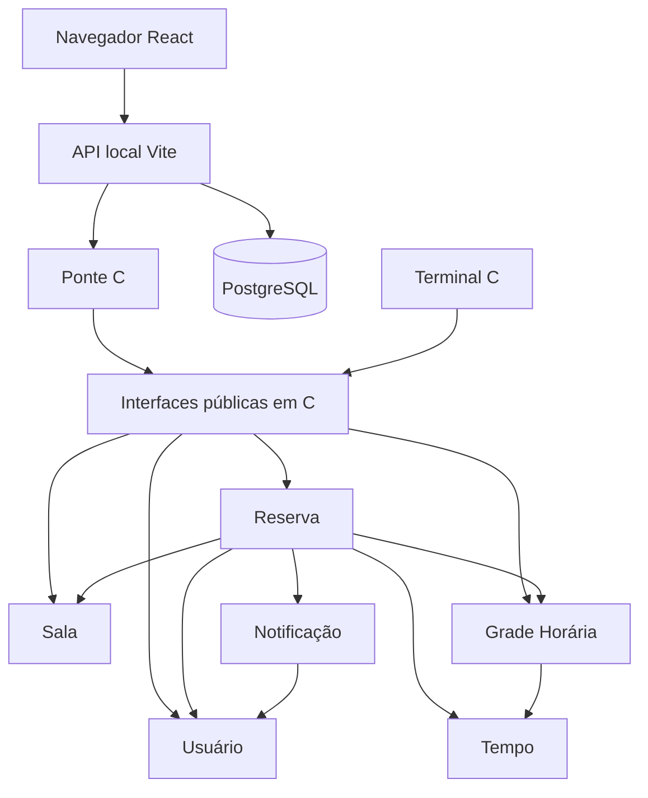

# Sistema de Reserva de Salas - Refatorado

Especificação de requisitos, arquitetura modular e plano de testes

PUC-Rio · INF1040 · Programação Modular · 2026.2

- Danilo de Castro Alves Nascimento · 2320401
- Heloysa Aguiar · 2320438

Novembro de 2026

O sistema permite a alunos reservar salas para estudo em grupo e a professores reservar salas para provas. A disponibilidade depende da grade de aulas, da capacidade e dos recursos da sala, das reservas ativas e das condições de uso de laboratórios.

Esta revisão responde ao parecer em `pedidoalteracao.txt` e toma como referência a especificação original e o repositório do projeto.

## Conteúdo

- [1. Requisitos funcionais e regras de negócio](#1-requisitos-funcionais-e-regras-de-negócio)
- [2. Requisitos não funcionais](#2-requisitos-não-funcionais)
- [3. Arquitetura de módulos](#3-arquitetura-de-módulos)
- [4. Interfaces e persistência](#4-interfaces-e-persistência)
- [5. Isolamento dos testes](#5-isolamento-dos-testes)
- [6. Casos unitários dos módulos de apoio](#6-casos-unitários-dos-módulos-de-apoio)
- [7. Casos unitários do módulo Reserva](#7-casos-unitários-do-módulo-reserva)
- [8. Cobertura de regras, integração e interface](#8-cobertura-de-regras-integração-e-interface)
- [9. Execução e rastreabilidade da revisão](#9-execução-e-rastreabilidade-da-revisão)

## 1. Requisitos funcionais e regras de negócio

### Requisitos funcionais

| ID | O sistema deve permitir |
| --- | --- |
| RF01 | Cadastrar usuários com matrícula de 1 a 19 dígitos, nome, e-mail e perfil. A matrícula mantém zeros à esquerda. Na interface web, verificar o cadastro antes de liberar a solicitação. |
| RF02 | Cadastrar salas com código, tipo, capacidade e indicação de quadro. Na web, gravar e apresentar o inventário no PostgreSQL. |
| RF03 | Cadastrar aulas recorrentes por sala, disciplina, ministrante, dia da semana e horário. |
| RF04 | Registrar autorizações de prova associadas a uma ocorrência de aula na sala. |
| RF05 | Registrar e consultar o vínculo da biometria de um monitor cadastrado ao laboratório. |
| RF06 | Buscar salas disponíveis por data, horário, quantidade de pessoas, quadro e perfil do solicitante. |
| RF07 | Solicitar uma reserva, consultar seu histórico por matrícula e cancelar uma reserva ativa como titular. |
| RF08 | Comunicar aos titulares o cancelamento de reservas substituídas por uma prova. |

### Regras de negócio

| ID | Condição para a operação |
| --- | --- |
| RN01 | A reserva exige um usuário cadastrado, uma sala existente e quantidade positiva de pessoas até a capacidade da sala. A busca também aplica o filtro de quadro quando solicitado. |
| RN02 | O código da sala começa com letra maiúscula do edifício, seguida de dois a cinco algarismos. O primeiro algarismo indica o andar, como em `L201`. |
| RN03 | Durante uma aula, só pode reservar um professor para `PROVA`. Cada aula sobreposta deve ser do solicitante ou ter autorização do respectivo ministrante para a data e o primeiro minuto da sobreposição. |
| RN04 | Uma reserva de laboratório feita por aluno exige a indicação de um monitor cadastrado com biometria vinculada àquele laboratório. A busca comum para alunos exibe salas comuns. |
| RN05 | Há conflito entre reservas ativas da mesma sala e data quando o início de cada intervalo é anterior ao fim do outro. Horários consecutivos podem coexistir. |
| RN06 | A prioridade só se aplica a professor solicitando `PROVA` quando **todas** as reservas conflitantes são de alunos e faltam **pelo menos 120 minutos para o início de cada uma**. O prazo usa a reserva a cancelar, inclusive se a prova começa depois. A operação exige aceite de todos os avisos. |
| RN07 | Os demais conflitos são recusados, incluindo prova contra professor, estudo de professor contra aluno e qualquer solicitação de aluno que conflite com reserva ativa. A recusa mantém as reservas anteriores ativas. |
| RN08 | O titular pode cancelar a própria reserva ativa. O histórico conserva os registros com situação `ATIVA` ou `CANCELADA`. |

## 2. Requisitos não funcionais

Critérios verificáveis para o ambiente local do projeto e para a integridade das operações.

| Dimensão | Critério de aceitação |
| --- | --- |
| **RNF01** · Segurança | A API local escuta no endereço de loopback. O servidor rejeita reservas sem matrícula cadastrada, cancelamentos por matrícula diferente da titular e autorizações atribuídas a quem não ministra a aula. A conexão do PostgreSQL é configurada no servidor por `DATABASE_URL`. Verificar as recusas pela API, além da interface. |
| **RNF02** · Desempenho | Meta proposta de percentil 95 de até 500 ms para a busca HTTP local, com 100 salas e 500 registros de reserva. Realizar 100 buscas sequenciais após o aquecimento, com o núcleo compilado e o PostgreSQL local ativo. Registrar ambiente e tempos obtidos. |
| **RNF03** · Disponibilidade | Com o PostgreSQL acessível, o frontend deve carregar o inventário após reiniciar. Se o banco ficar indisponível, a API de salas informa indisponibilidade e as consultas podem ser retomadas quando a conexão voltar. |
| **RNF04** · Confiabilidade | Uma solicitação recusada deixa as reservas conflitantes ativas e deixa o histórico do solicitante sem a nova reserva. Isso se aplica a conflito impeditivo, falta de prazo e falha no canal de comunicação. |
| **RNF05** · Integridade | Em uma sessão, o núcleo mantém no máximo uma reserva ativa para qualquer minuto de uma mesma sala e data. Toda substituição valida o conjunto de conflitos antes de alterá-lo. O PostgreSQL mantém um único registro para cada código de sala e capacidade positiva, inclusive em cadastros concorrentes. |
| **RNF06** · Persistência | Uma sala cadastrada pela web deve conservar código, tipo, capacidade e quadro após reiniciar o servidor. O inventário gravado volta a alimentar a busca e as reservas. Os demais cadastros e o histórico ficam em memória durante a sessão. |

### Consistência na substituição por prova

1. Validar solicitante, sala, intervalo, grade e condições do laboratório.
2. Reunir as reservas ativas sobrepostas e conferir se toda a lista satisfaz a regra de prioridade e a antecedência.
3. Solicitar a entrega dos avisos. Se algum critério falhar ou o canal recusar o lote, encerrar a solicitação com o estado anterior preservado.
4. Após aceite do canal, marcar as reservas anteriores como canceladas, registrar a prova ativa e retornar o novo identificador.

> **Escopo do ambiente.** A matrícula identifica o usuário no ambiente local de teste. Para uso com contas reais, a evolução deve prever autenticação e vincular a matrícula a uma sessão autenticada. A meta de desempenho é um critério de aceitação a medir.

## 3. Arquitetura de módulos

As entradas usam as interfaces públicas do núcleo C. Os dados de cada módulo ficam encapsulados, e o repositório PostgreSQL é acessado pela API web.



| Módulo | Responsabilidade e dependências |
| --- | --- |
| Usuário | Cadastrar matrícula, nome, e-mail e perfil e responder a consultas por matrícula. |
| Sala | Validar códigos, capacidade, tipo e quadro. Manter o inventário do núcleo e o vínculo de biometria por laboratório. |
| Grade Horária | Manter aulas recorrentes, identificar ministrantes e registrar autorizações por ocorrência. A autorização pertence à Grade porque se refere a uma aula específica e a quem a ministra. |
| Reserva | Consultar Usuário, Sala e Grade, aplicar as regras de elegibilidade, conflito e antecedência, acionar Notificação e atualizar o histórico. A decisão sobre aceitar a reserva fica neste módulo. |
| Notificação | Consultar Usuário para obter os endereços, compor e encaminhar o lote de avisos já autorizado e retornar o resultado da entrega. |
| Tempo | Fornecer operações de calendário, horários e sobreposição, usadas pela Grade e por Reserva. |

> **Decisão de projeto.** As regras do domínio ficam em funções internas de Reserva, junto da coordenação da operação. Reserva calcula a antecedência de todas as reservas conflitantes antes de chamar Notificação para enviar os avisos. Um módulo de regras separado pode ser adotado se a complexidade crescer.

## 4. Interfaces e persistência

### Contratos em C

| Interface | Operações principais |
| --- | --- |
| `usuario.h` | `usu_cadastrar`, `usu_existe`, `usu_obterTipo` e `usu_obterEmail` cadastram e consultam dados do usuário por matrícula. |
| `sala.h` | `sala_validarCodigo`, `sala_verificarCadastro` e `sala_cadastrar` validam e cadastram salas. `sala_obterCapacidade`, `sala_obterTipo` e `sala_listarPorCapacidade` consultam o inventário. `sala_registrarBiometria` e `sala_temMonitorComBiometria` mantêm o vínculo do monitor. |
| `grade.h` | `grade_cadastrarAula` e `grade_temAula` mantêm e consultam aulas. `grade_registrarAutorizacao`, `grade_temAutorizacao` e `grade_permiteProva` fornecem as permissões vinculadas aos horários. |
| `reserva.h` | `res_buscarSalasLivres`, `res_verificarConflito`, `res_solicitar`, `res_cancelar` e `res_listarPorUsuario` coordenam a disponibilidade e o ciclo de uma reserva. |
| `notificacao.h` | `not_enviar` envia uma mensagem. `not_avisarCancelamento` e `not_avisarCancelamentos` recebem os cancelamentos aprovados por Reserva e reportam a entrega ou falha. O terminal oferece simulação e SMTP opcional. A web simula os avisos. |

**Tipos comuns.** Data em `dd/mm/aaaa`, hora em `hh:mm` e dia da semana de 1 (segunda-feira) a 7 (domingo). Os perfis são `ALUNO` e `PROFESSOR`. Os tipos de sala são `COMUM` e `LABORATORIO`. Reserva usa finalidade `ESTUDO` ou `PROVA`.

### Inventário no PostgreSQL

| Campo | Tipo e condição |
| --- | --- |
| `codigo` | `varchar(6)`, chave primária, formato validado também pelo núcleo C. |
| `tipo` | `smallint`, 0 para sala comum e 1 para laboratório. |
| `capacidade` | `integer` positivo. |
| `tem_quadro` | `boolean`. |

No cadastro web, a API lê o inventário dentro de uma transação, verifica os dados no núcleo C e grava a sala com uma consulta parametrizada. A confirmação vem após o commit. A API consulta o banco nas operações que dependem do inventário e carrega as salas necessárias no núcleo.

**Fontes no repositório.** `Reserva/tipos.h`, cabeçalhos dos módulos, `frontend/server/bridge.c`, `frontend/server/salas.mjs` e `frontend/server/salas.sql`.

## 5. Isolamento dos testes

Cada caso unitário exercita uma função pela interface pública e verifica o retorno, os dados de saída e os efeitos observáveis.

### Preparação e execução por caso

1. Executar cada identificador em um processo novo. Iniciar com estado vazio e preparar apenas a base e as condições descritas naquele caso. Os subcasos de uma mesma linha também são independentes.
2. Montar o cenário com chamadas públicas ou configurar os dublês antes da chamada sob teste. Capturar os IDs produzidos pela preparação e zerar os registros do canal falso de avisos.
3. Executar a chamada, verificar o resultado e consultar novamente o estado se o caso altera reservas. Encerrar o processo ao final.

### Controle das dependências

| Unidade | Dependência controlada |
| --- | --- |
| Usuário e Sala | Executar cada módulo real isoladamente. Preparar cadastros e vínculos pela interface pública. |
| Grade Horária | Executar Grade com datas e horas fixas. O utilitário Tempo recebe testes próprios para calendário, limites e intervalos adjacentes. |
| Notificação | Substituir `usu_obterEmail` por respostas fixas. Injetar um canal que registre destinatários e mensagens e simule aceite ou falha. |
| Reserva | Ligar dublês de Usuário, Sala, Grade e Notificação, mantendo Reserva real. Os dublês retornam perfis, capacidade, tipo, vínculo de biometria e permissões definidos no cenário. Notificação registra os avisos solicitados e simula a resposta. O instante do pedido é fornecido por `DataHora`. |

### Base reutilizável

| Item | Dados iniciais |
| --- | --- |
| Usuários | 1001 e 1002 são alunos, 3001 é aluno monitor, 2001 e 2002 são professores. Para U1, omitir 1002 da sua base. |
| Salas | L201 comum, 40 lugares, com quadro. L105 comum, 10 lugares, sem quadro. L301 laboratório, 30 lugares, sem quadro, com vínculo de biometria para 3001. |
| Grade | Cálculo em L201, segunda-feira, 09:00–11:00, ministrado por 2001. Autorizações começam vazias. |
| Data e reservas | **D** = 19/10/2026, segunda-feira. Reservas começam vazias. Nos casos da seção 7, a letra **E** indica que a preparação cria um estudo ativo de 1001 em L201, em D, das 14:00 às 16:00, para 5 pessoas. Cada caso cria seu próprio E. |

> **Execução automatizada.** `make test-unit` chama `Testes/test_unitarios.py`, que descobre os identificadores com `--listar` e inicia um processo para cada um. Por exemplo, `build/unit_reserva R12` roda apenas R12 no Linux. Os dublês estão em `Testes/unit_reserva.c` e `Testes/unit_notificacao.c`.

## 6. Casos unitários dos módulos de apoio

As entradas usam a base da seção 5. Cada identificador e subcaso é executado com preparação própria.

| Caso | Entrada ou condição | Resultado esperado |
| --- | --- | --- |
| U1–U3 | Cadastrar 1002 ausente com dados válidos. Cadastrar 1001 duplicado. Cadastrar usuário com nome vazio. | `USU_OK`, `USU_JA_EXISTE` e `USU_DADOS_INVALIDOS`, respectivamente. |
| U4–U7 | Consultar existência de 1001 e 9999, perfil de 2001, perfil de 9999 e e-mail de 1001. | 1 e 0 em U4, perfil professor em U5, `USU_NAO_ENCONTRADO` em U6 e e-mail cadastrado em U7. |
| S1–S2 | Validar L201. Validar 201L, L e LX01. | 1 para L201 e 0 para os demais códigos. |
| S3–S6 | Cadastrar L402 comum com 25 lugares e quadro. Usar código inválido, repetir L201 ou informar capacidade 0. | `SALA_OK`, `SALA_CODIGO_INVALIDO`, `SALA_JA_EXISTE` e `SALA_CAPACIDADE_INVALIDA`, respectivamente. |
| S7–S8 | Consultar capacidade de L105 e L999. Consultar tipo de L301 e L999. | 10 para L105, laboratório para L301 e `SALA_NAO_ENCONTRADA` para L999. |
| S9–S11 | Listar salas para 30 sem filtro de quadro, 15 com quadro e 100 sem filtro. | L201 e L301 em S9, somente L201 em S10 e `SALA_NENHUMA` em S11. |
| S12–S13 | Registrar biometria de 3001 em L999. Consultar vínculo de 3001 e de 1001 em L301. | `SALA_NAO_ENCONTRADA` em S12, 1 para 3001 e 0 para 1001 em S13. |
| G1–G3 | Cadastrar aula em L105 na segunda, 14:00–16:00. Cadastrar sobreposição em L201, 10:00–12:00. Informar fim anterior ao início. | `GRADE_OK`, `GRADE_CONFLITO` e `GRADE_HORARIO_INVALIDO`, respectivamente. |
| G4–G5 | Consultar L201 em D, 09:00–10:00 e 13:00–14:00. | 1 com ministrante 2001 no primeiro intervalo e 0 no segundo. |
| G6–G8 | 2001 autoriza 2002 em D às 09:00. 2002 tenta autorizar a mesma aula. 2001 tenta autorizar às 13:00. | `GRADE_OK`, `GRADE_NAO_MINISTRANTE` e `GRADE_SEM_AULA`, respectivamente. |
| G9 | Preparar autorização de 2001 para 2002 em L201, D às 09:00. Consultar 2002 e 1001. | 1 para 2002 e 0 para 1001. Preparar a autorização em cada subcaso. |
| N1–N2 | Enviar “teste” para 1001 conhecido e para 9999 ausente. | `NOT_OK` com uma entrega ao e-mail de 1001, e `NOT_USUARIO_INEXISTENTE` sem entrega para 9999. |
| N6 | Encaminhar aviso de cancelamento já aprovado para 1001. | Uma comunicação ao destinatário cadastrado com sala, data e horário do cancelamento. |
| N7 | Configurar a recusa do canal para um lote de avisos válido. | `NOT_FALHA_ENTREGA`. O resultado informa a recusa do canal. |

Os casos temporais N3, N4 e N5 da versão original passam para Reserva como R22, R23 e R24 (seção 8).

## 7. Casos unitários do módulo Reserva

D é a data de referência. E é uma reserva ativa criada na preparação do caso. A sigla E em diferentes linhas representa instâncias independentes. O pedido usa D às 08:00, 5 pessoas e nenhum monitor, salvo condição indicada.

| Caso | Estado inicial e ação | Resultado esperado |
| --- | --- | --- |
| R1 | Estado vazio. 1001 solicita estudo em L201, 14:00–16:00. | `RES_OK`, ID gerado e reserva ativa. |
| R2 | 9999 solicita reserva. | `RES_USUARIO_INEXISTENTE`. |
| R3 | 1001 solicita L105 para 20 pessoas. | `RES_CAPACIDADE_EXCEDIDA`. |
| R4 | 1001 solicita estudo em L201, 09:00–10:00. | `RES_HORARIO_AULA`. |
| R5 | 2002 solicita prova em L201, 09:00–10:00, sem autorização. | `RES_HORARIO_AULA`. |
| R6 | Preparar autorização de 2001 para 2002 às 09:00. 2002 solicita prova em L201, 09:00–10:00. | `RES_OK`, prova ativa. |
| R7 | Preparar a autorização de 2001 para 2002. 2002 solicita estudo às 09:00. | `RES_HORARIO_AULA`. |
| R8 | 1001 solicita estudo em L301, 14:00–16:00, sem monitor. | `RES_LAB_SEM_MONITOR`. |
| R9 | 1001 solicita estudo em L301, 14:00–16:00, com 3001. | `RES_OK`. |
| R10 | Preparar E. 1002 solicita estudo em L201, 15:00–17:00. | `RES_CONFLITO`. E ativa. |
| R11 | Preparar E. 2001 solicita prova em L201, 14:00–16:00, às 10:00. | `RES_OK`. E cancelada, um aviso aceito e prova ativa. |
| R12 | Preparar E. 2001 solicita prova em L201, 14:00–16:00, às 13:00. | `RES_ANTECEDENCIA_INSUFICIENTE`. E ativa, sem aviso nem prova. |
| R13 | Preparar prova ativa de 2001 em L201, 14:00–16:00. 2002 solicita prova no mesmo horário. | `RES_CONFLITO`. Prova de 2001 ativa. |
| R14 | Preparar E. Verificar conflito em L201, 15:00–16:00. | 1 e ID da E criada na preparação. |
| R15 | Preparar E. Verificar conflito em L201, 16:00–17:00. | 0. O intervalo começa no fim de E. |
| R16 | Preparar E. 1001 busca 30 lugares, 14:00–16:00, sem filtro de quadro. | `RES_NENHUMA_SALA`. |
| R17 | Preparar E. 2001 busca 30 lugares, 14:00–16:00, sem filtro de quadro. | `RES_OK`, somente L301. |
| R18 | Preparar E. 1001 cancela o ID de E. | `RES_OK`. E cancelada e período liberado. |
| R19 | Preparar E. 2002 tenta cancelar o ID de E. | `RES_NAO_AUTORIZADO`. E ativa. |
| R20 | 1001 tenta cancelar o ID 9999 ausente. | `RES_NAO_ENCONTRADA`. |
| R21 | Consultar histórico de 1001 com E preparada. Em outro processo, consultar 1002 sem reservas. | `RES_OK` com E para 1001 e `RES_NENHUMA_RESERVA` para 1002. |

## 8. Cobertura de regras, integração e interface

### Cenários unitários adicionais

| Caso | Estado inicial e ação | Resultado esperado |
| --- | --- | --- |
| R22–R24 | Preparar E em cada caso. 2001 solicita prova sobreposta às 11:00, 12:00 e 12:01, respectivamente. Em outro subcaso de R24, solicitar às 12:30. | Aceite com 180 e 120 minutos, recusa com 119 e 90. A recusa não emite aviso e mantém E ativa. |
| R25 | 2001 solicita prova em sua própria aula, em L201 em D, 09:00–10:00. | `RES_OK`. Cobre o ministrante solicitante, ao lado de R5 e R6 para outro professor. |
| R26 | 1001 solicita prova durante aula, com permissão de aula simulada no dublê. | `RES_HORARIO_AULA`. O perfil do solicitante continua sendo exigido. |
| R27 | 2002 pede prova das 10:00 às 12:00. O dublê da Grade simula autorização de apenas uma aula e, em outro processo, autorização de ambas. A integração repete o cenário com aulas reais de 2001 e 2003. | Recusa com permissão parcial e aceite quando as duas ocorrências estiverem autorizadas. |
| R28 | Preparar E. 2001 solicita estudo no horário de E. Em outro caso, 1001 tenta sobrepor uma prova de 2001. | `RES_CONFLITO` em ambos os casos. Reservas anteriores ativas. |
| R29 | Preparar E. 2001 pede prova com prazo suficiente. O canal falso recusa o lote. | `RES_FALHA_NOTIFICACAO`. E ativa e nenhuma prova criada. |
| R30 | Preparar estudos de alunos às 14:00–15:00 e 15:00–16:00. 2001 pede prova às 14:30–15:30 com prazo suficiente para as duas. | As duas reservas são canceladas, os dois avisos são aceitos e a prova fica ativa. |
| R31 | Preparar os mesmos estudos em processo novo. Solicitar a prova às 12:01. | Recusa por prazo insuficiente para o primeiro estudo. Os dois estudos seguem ativos e nenhum aviso é enviado. |

### Testes de integração e interface

| Suíte | Fluxos e verificações |
| --- | --- |
| Integração C | Usar os módulos reais para exercitar aulas e autorizações, laboratório com vínculo de monitor, recusa por falta de prazo, falha no canal e substituição de mais de uma reserva. Observar estados e destinatários. |
| Terminal | Executar o menu por subprocesso. Verificar entrada inválida, busca, reserva, cancelamento, histórico e envio ou recusa por um servidor SMTP local de teste. |
| API web | Exercitar cadastro, verificação de matrícula, regras de reserva, criação concorrente de sala, reinício da API e nova busca no PostgreSQL. Usar um esquema temporário de teste. |
| Navegador | Verificar recusa de matrícula desconhecida, cadastro e reserva após verificação. Em Cadastros, incluir sala, conferir a lista e confirmar que a sala reaparece após reiniciar a aplicação. |

## 9. Execução e rastreabilidade da revisão

### Aplicação e testes do núcleo

Na raiz do repositório, com GCC, GNU Make e Python 3, execute no Linux ou Ubuntu via WSL.

```sh
make
./build/sistema_reserva
make test
```

No Windows com MinGW, use `mingw32-make CC=gcc` e `mingw32-make CC=gcc test`. O executável é `build/sistema_reserva.exe`. A suíte C completa foi verificada no Ubuntu via WSL.

### Interface web e banco

Com Node.js, GCC e Docker, execute no PowerShell. Para um PostgreSQL existente, configure `DATABASE_URL` em `frontend/.env`.

```powershell
cd frontend
if (-not (Test-Path .env)) { Copy-Item .env.example .env }
docker compose up -d --wait
npm.cmd ci
npm.cmd run dev
```

Abra o endereço exibido pelo Vite. Use **Cadastro de usuário**, **Cadastros → Salas** e **Nova reserva → Verificar matrícula** para o fluxo básico. O teste de API com o PostgreSQL é executado por `npm.cmd test` dentro de `frontend`.

### Correspondência com o parecer

| Ponto solicitado | Onde é atendido |
| --- | --- |
| Classificar requisitos e detalhar a prioridade de prova | Seções 1 e 2. RF01–RF08, RN01–RN08 e RNF01–RNF06. |
| Especificar consistência diante de conflitos e falhas | Seção 2 e casos R29–R31. |
| Delimitar Reserva, Grade Horária e Notificação | Seções 3 e 4. Reserva é responsável pela antecedência e Notificação encaminha os avisos aprovados. |
| Controlar as dependências e restaurar o estado por caso | Seção 5. Dublês, preparação por processo e estados independentes de R1, R11, R12 e R14. |
| Cobrir as alternativas de autorização durante aulas | R5, R6, R7 e R25–R27. Inclui o ministrante, outro professor com e sem autorização e sobreposição de aulas. |

**Referências do projeto.** *Sistema de Reserva de Salas de Aula* (especificação original), `pedidoalteracao.txt`, `README.md`, `frontend/README.md`, `Testes/` e `frontend/test/api.test.mjs`.
